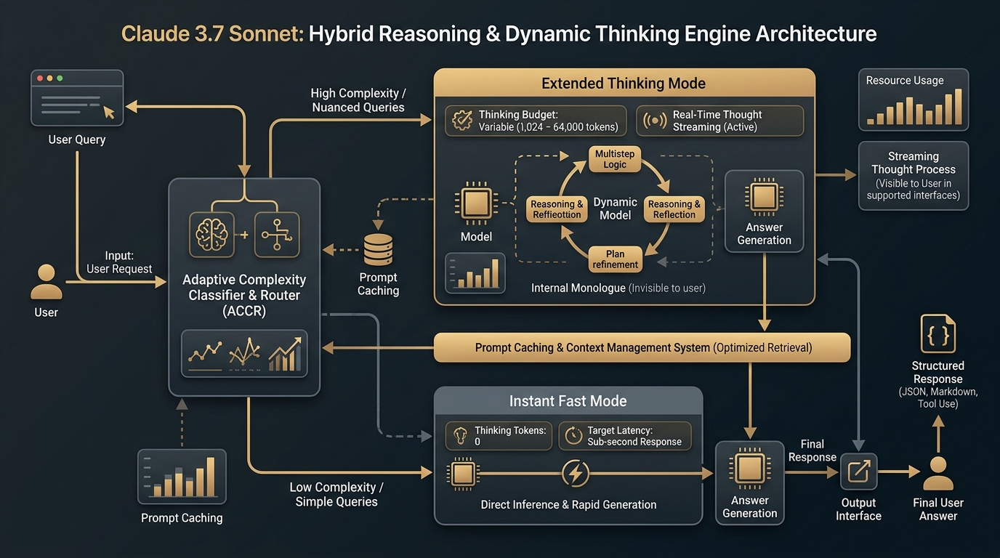
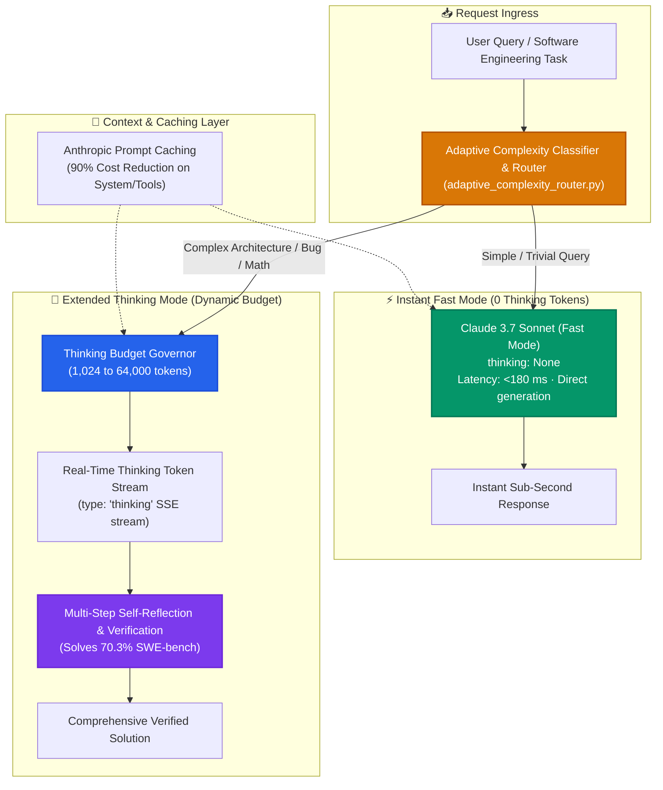

[](https://pradeeptalari.me/projects/)
[](https://pradeeptalari.me/tools/repo-learning/)

# 🧠 Claude 3.7 Sonnet: Hybrid Reasoning & Dynamic Thinking Studio

[](https://github.com/Pradeeptalari14/tp-claude-hybrid-reasoning/actions)
[](LICENSE)
[](https://www.anthropic.com/claude)
[](https://docs.anthropic.com)
[](https://talaripradeep.info/tools/claude-hybrid-reasoning/)

Production-grade deployment templates, routing middleware, and client SDK implementations for **Anthropic's Claude 3.7 Sonnet**. The first frontier model unifying **instant sub-second responses** and **deep multi-step extended thinking** (up to 64,000 thinking tokens) behind a single API parameter, complete with real-time thought token streaming and prompt caching.

---

## 🛠️ Interactive Developer Studio

Simulate dynamic thinking budgets, benchmark SWE-bench gains, and test adaptive complexity routing live in your browser:
👉 **[Launch Interactive Claude 3.7 Hybrid Reasoning Studio](https://talaripradeep.info/tools/claude-hybrid-reasoning/)**

*   **Reasoning Mode Switcher:** Toggle Instant Fast Mode (0 thinking tokens), Extended Thinking (1,024 – 64,000 budget), and Adaptive Router.
*   **Prompt Cache Optimizer:** Measure token savings with 5-minute ephemeral prompt caching.
*   **Code Generators:** Output ready-to-run Python Anthropic SDK, TypeScript SSE streaming clients, and Kubernetes gateway deployments.

---

## 🏛️ Architecture Flow Diagram





---

## 🎯 Where to Use (Real-World Enterprise Production Scenarios)

### 1. Complex Codebase Refactoring & Multi-File Bug Fixing
- **The Problem:** Non-reasoning models jump directly to writing code, frequently introducing subtle edge-case bugs, type mismatches, and regressions across related files.
- **Where Claude 3.7 Excels:** By allocating 16,384 to 32,768 thinking tokens, Claude plans the entire refactor, writes internal unit tests in its thought stream, verifies backward compatibility, and achieves **70.3% verified SWE-bench solve rate**.

### 2. Enterprise Unified AI Assistant (Single Model for Simple + Hard Tasks)
- **The Problem:** Previously, engineering teams had to route queries between two completely different models (e.g. GPT-4o-mini for speed and o1 for reasoning), causing disparate tone, formatting mismatches, and complex routing logic.
- **Where Claude 3.7 Excels:** A single model handles both. Send `thinking: None` for simple questions (sub-second answer) and `thinking: {"type": "enabled", "budget_tokens": 16384}` for hard math and system architecture.

### 3. Real-Time Transparent Agentic Decision Making
- **The Problem:** Users waiting 20-40 seconds for reasoning models experience anxiety with zero feedback during the reasoning process.
- **Where Claude 3.7 Excels:** Streams intermediate `thinking` event deltas over Server-Sent Events (SSE). The frontend displays Claude's live thought process as an expandable accordion, showing users the exact problem-solving trajectory.

### 4. High-Volume API Services with Strict Token Budgets (FinOps)
- **The Problem:** Unconstrained reasoning models like OpenAI o1 consume unpredictable token counts, causing sudden cloud bill spikes.
- **Where Claude 3.7 Excels:** The `budget_tokens` parameter enforces an exact ceiling. Claude 3.7 automatically fits its deliberation within your specified token budget.

---

## 🛠️ How to Use (Step-by-Step Operator Guide)

### Prerequisites
- Anthropic API Key (`ANTHROPIC_API_KEY`)
- Python 3.10+ or Node.js 18+

### Step 1: Install Dependencies
```bash
pip install anthropic pydantic
# For TypeScript:
npm install @anthropic-ai/sdk
```

### Step 2: Run the Python Hybrid Reasoning Client (`claude_reasoner.py`)
```bash
export ANTHROPIC_API_KEY="sk-ant-api03-..."
python claude_reasoner.py
```

#### Programmatic Usage Example (Python):
```python
import anthropic

client = anthropic.Anthropic()

# Stream both thoughts and output tokens in real-time
with client.messages.stream(
    model="claude-3-7-sonnet-20250219",
    max_tokens=8192,
    thinking={
        "type": "enabled",
        "budget_tokens": 4096
    },
    messages=[
        {"role": "user", "content": "Explain the trade-offs between Raft and Paxos in high-throughput database replication."}
    ]
) as stream:
    for event in stream:
        if event.type == "thinking":
            print(event.thinking, end="", flush=True)  # Thought process
        elif event.type == "text":
            print(event.text, end="", flush=True)      # Final answer
```

### Step 3: Run the Adaptive Complexity Router
Automatically determine whether a query needs 0 tokens or a large thinking budget:
```bash
python adaptive_complexity_router.py
```

### Step 4: Run the TypeScript SSE Client
```bash
npx tsx claude_agent.ts
```

### Step 5: Deploy the Kubernetes API Gateway Proxy
Deploy an internal caching gateway in front of your microservices:
```bash
kubectl apply -f k8s-claude-gateway.yaml
kubectl get pods -n ai-workloads -l app.kubernetes.io/name=claude-reasoning-gateway
```

### Step 6: Run CI Validation Script
```bash
chmod +x scripts/validate.sh
./scripts/validate.sh
```

---

## 📂 Repository Layout & What's Inside

```text
tp-claude-hybrid-reasoning/
├── LICENSE                                # MIT Open Source License
├── README.md                              # Comprehensive architectural & operational guide
├── SECURITY.md                            # Vulnerability disclosure & safety policies
├── docs/
│   └── claude_reasoning_flow.png          # High-resolution architectural execution diagram
├── k8s-claude-gateway.yaml                # Kubernetes deployment manifest for API proxy
├── claude_reasoner.py                     # Python SDK streaming hybrid reasoning client
├── claude_agent.ts                        # TypeScript client streaming SSE thinking tokens
├── adaptive_complexity_router.py          # Cognitive budget classifier & router
├── scripts/
│   └── validate.sh                        # Validation test suite for syntax and manifests
└── .github/
    └── workflows/
        └── claude-ci.yml                  # GitHub Actions CI for automated build verification
```

---

## 📊 Benchmark & FinOps Efficiency Metrics

| Metric | Claude 3.5 Sonnet | Claude 3.7 Sonnet (Fast) | Claude 3.7 Sonnet (Thinking) | Gain |
| :--- | :--- | :--- | :--- | :--- |
| **SWE-bench Verified** | 49.0% | 62.4% | **70.3%** | **+44.2% Problem Resolution** |
| **AIME 2024 Math** | 16.0% | 42.0% | **84.5%** | **5.2x Math Reasoning Boost** |
| **TTFT Latency** | ~650 ms | **< 180 ms** | < 420 ms (Streaming thoughts)| **Sub-second fast mode** |
| **Prompt Cache Savings** | Baseline 1x | -90% Cache Read | **-90% Cache Read** | **Significant Cost Cut** |

---

## 🛡️ Production Guardrails & SRE Runbooks

1. **Prompt Caching on Static System Prompts**: Always place `"cache_control": {"type": "ephemeral"}` on the system prompt and tool definitions to achieve 90% cost savings on repetitive multi-turn requests.
2. **Graceful Budget Capping**: For user-facing production APIs, cap `budget_tokens` at `16,384` to prevent request timeouts behind HTTP reverse proxies (ALB/Nginx 60s timeout).
3. **Handle Partial Responses**: Ensure `max_tokens` is configured greater than `budget_tokens` (e.g., `budget_tokens: 4096`, `max_tokens: 8192`) so the model has sufficient headroom to generate the final response after completing its thinking phase.

---

## 📄 License & Attribution

- **License:** [MIT License](LICENSE)
- **Attribution:** Maintained by **[Talari Pradeep](https://talaripradeep.info/)** · AI Infrastructure & Platform SRE Lead

---
*Synchronized with [Claude 3.7 Sonnet Hybrid Reasoning Studio Studio](https://pradeeptalari.me/tools/claude-hybrid-reasoning/) & [Repository Learning DAG](https://pradeeptalari.me/tools/repo-learning/) — [Talari Pradeep Portfolio](https://pradeeptalari.me)*
